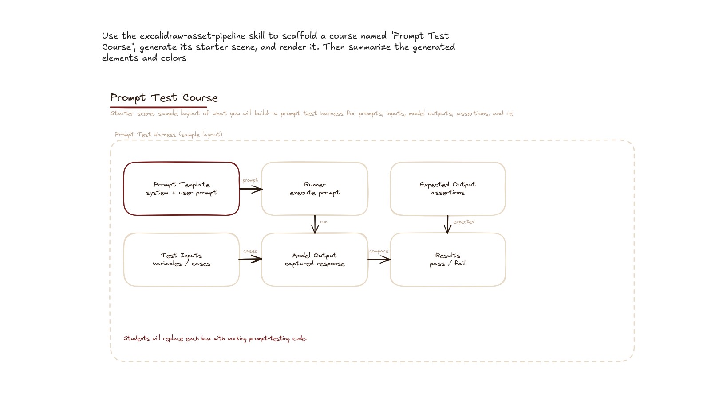

# Excalidraw Asset Pipeline

OpenCode skill and tooling for branded Excalidraw diagrams: scaffold a course, author scenes with the shared kit, render PNGs.

## TL;DR

- Scaffold a course: `python3 tools/new_course.py "Course Name"`
- Generate scenes: `python3 generators/<slug>/generator/generate.py`
- Render PNGs: `python3 tools/render_course.py <slug>`
- Validate brand: `python3 tools/brand/validate.py` (if available)
- Install skill: `bash tools/install_skill.sh`

## Skill

Skill location: `.opencode/skills/excalidraw-asset-pipeline/SKILL.md`

## Commands

- `make new NAME="Course Name"`
- `make render SLUG=course-slug`
- `make test`
- `make install-skill`

## Layout

- `generators/<slug>/` - course generators
- `generators/common/` - shared drawing kit and brand tokens
- `templates/course/` - scaffold template
- `tools/` - renderer and skill tooling
- `docs/` - documentation assets

## Generated output

Generated scenes and PNGs are ignored by Git. Regenerate them from the course generators.
